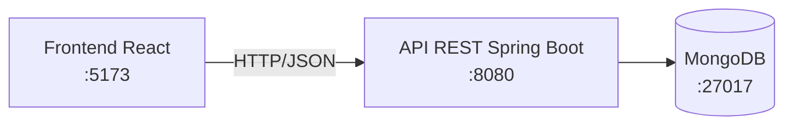
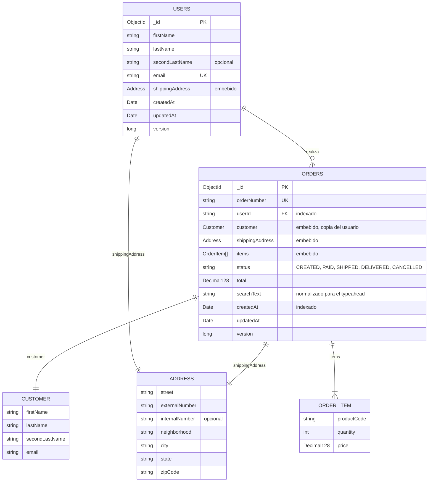

# Puerto Orders · Gestión de pedidos

Sistema para gestionar los pedidos realizados en la aplicación y en el sitio web: API REST con interfaz web para listar, buscar (typeahead) y consultar el detalle de los pedidos.

**Stack:** Java 21 · Spring Boot · MongoDB · React + TypeScript (Vite) · Tailwind CSS · OpenAPI / Swagger



## Modelo de datos

Dos colecciones, `users` y `orders`. `Customer`, `Address` y `OrderItem` son documentos embebidos, no colecciones. El pedido guarda una copia de los datos del cliente y la dirección al momento de la compra, para conservar el histórico aunque el usuario cambie.



## Requisitos

- JDK 21
- Node.js 20.19 o superior
- Docker Desktop

## Levantar el proyecto en local

**1. Clonar el repositorio**

```bash
git clone https://github.com/TU_USUARIO/puerto-orders.git
cd puerto-orders
```

**2. Levantar MongoDB**

```bash
docker compose up -d
```

**3. Levantar el backend con datos de prueba**

```bash
cd backend
./mvnw spring-boot:run -Dspring-boot.run.profiles=local
```

En Windows usa `mvnw.cmd`.

**4. Levantar el frontend** (en otra terminal)

```bash
cd frontend
npm install
cp .env.example .env.local
npm run dev
```

| Servicio | URL |
|---|---|
| Frontend | http://localhost:5173 |
| API REST | http://localhost:8080/api/v1 |
| Documentación del API (Swagger) | http://localhost:8080/swagger-ui.html |
| OpenAPI (JSON) | http://localhost:8080/v3/api-docs |

## Datos de conexión a la base de datos

| Parámetro | Valor |
|---|---|
| Host | `localhost` |
| Puerto | `27017` |
| Base de datos | `orders_db` |
| Usuario / contraseña | sin autenticación (solo desarrollo local) |
| URI | `mongodb://localhost:27017/orders_db` |

Para usar otra instancia (por ejemplo MongoDB Atlas), define `MONGODB_URI` antes de arrancar el backend:

```bash
export MONGODB_URI="mongodb+srv://<usuario>:<password>@<cluster>.mongodb.net/orders_db"
```

## Datos de prueba

Al arrancar con el perfil `local`, el backend carga automáticamente **12 usuarios y 30 pedidos** con distintos estatus, solo si la base está vacía. En el log aparece `Datos de prueba cargados: 12 usuarios y 30 pedidos`.

Para reiniciar los datos, borra la base y vuelve a arrancar el backend con el perfil `local`:

```bash
docker exec -it puerto-mongo mongosh orders_db --eval "db.dropDatabase()"
```

## Variables de entorno

| Variable | Default | Descripción |
|---|---|---|
| `MONGODB_URI` | `mongodb://localhost:27017/orders_db` | Conexión a MongoDB (backend) |
| `CORS_ORIGINS` | `http://localhost:5173` | Orígenes permitidos (backend) |
| `PORT` | `8080` | Puerto del API (backend) |
| `VITE_API_URL` | `http://localhost:8080/api/v1` | URL del API (frontend, `.env.local`) |

## Problemas comunes

| Problema | Solución |
|---|---|
| El frontend muestra "No se pudo conectar con el servidor" | Verifica que el backend esté corriendo en el puerto 8080 y que `CORS_ORIGINS` incluya la URL del frontend. |
| No aparecen pedidos | Arranca el backend con `-Dspring-boot.run.profiles=local`. Si la base ya tenía datos, no se vuelven a cargar; bórrala para reiniciar. |
